Video: https://youtu.be/iT1PmYgGK1I 

El proposito de esta topologia es demostrar el funcionamiento de una LAN DMZ y como gestionarla.

## Direccionamiento VLSM 

Matricula: 2025-1410

Red base: `14.10.0.0/16` (últimos 4 dígitos de la matrícula)

| # | Segmento | Red | Máscara | Prefijo | Hosts | Rango útil | Broadcast |
|---|----------|-----|---------|---------|-------|------------|-----------|
| 1 | VLAN 10 (Usuarios) | 14.10.10.0 | 255.255.255.128 | /25 | 126 | 14.10.10.1 - 14.10.10.126 | 14.10.10.127 |
| 2 | VLAN 20 (Admin) | 14.10.20.0 | 255.255.255.128 | /25 | 126 | 14.10.20.1 - 14.10.20.126 | 14.10.20.127 |
| 3 | DMZ (Servidores) | 14.10.30.0 | 255.255.255.240 | /28 | 14 | 14.10.30.1 - 14.10.30.14 | 14.10.30.15 |

### Asignación de IPs

| Dispositivo | Red | IP | Gateway |
|-------------|-----|----|---------|
| FortiGate (VLAN10) | VLAN 10 | 14.10.10.1/25 | - |
| FortiGate (VLAN20) | VLAN 20 | 14.10.20.1/25 | - |
| FortiGate (DMZ) | DMZ | 14.10.30.1/28 | - |
| Usuarios VLAN 10 (DHCP) | VLAN 10 | 14.10.10.10 - 14.10.10.120 | 14.10.10.1 |
| Usuarios VLAN 20 (DHCP) | VLAN 20 | 14.10.20.10 - 14.10.20.120 | 14.10.20.1 |
| Web Server: Sistema de Caja | DMZ | 14.10.30.2/28 | 14.10.30.1 |
| Web Server: Sistema de Inventario | DMZ | 14.10.30.3/28 | 14.10.30.1 |
| DB Server | DMZ | 14.10.30.4/28 | 14.10.30.1 |

## Topología

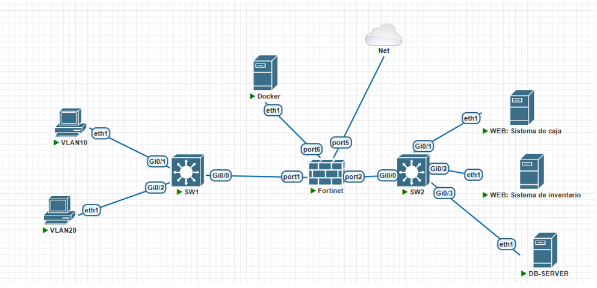

---

## Configuración en el FortiGate (GUI)

### Interfaces

### DHCP

### Rutas estáticas

### Objetos de dirección y FQDN

### Políticas de firewall

---

## Pruebas

### DMZ sin acceso abierto a Internet

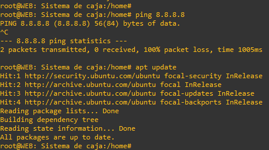

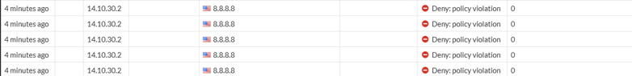

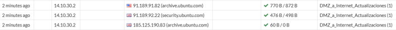

### SSH solo desde la VLAN 20

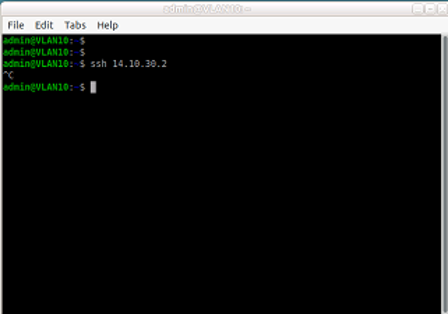

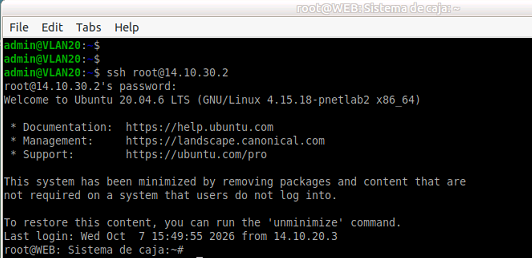

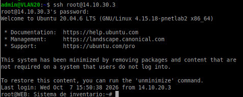

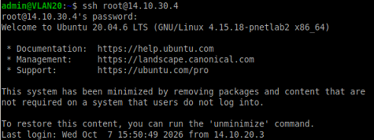

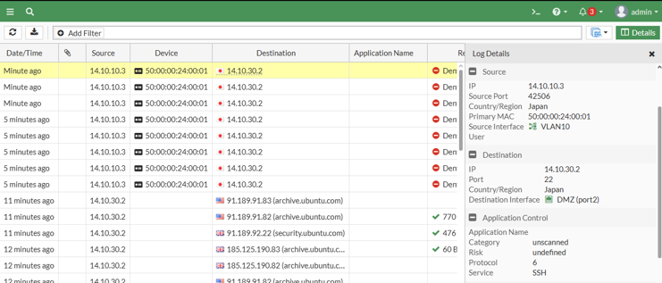

### VLAN 10 restringida al Web Server de Inventario

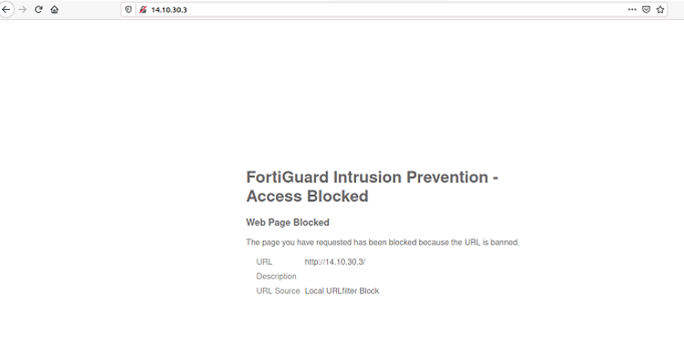

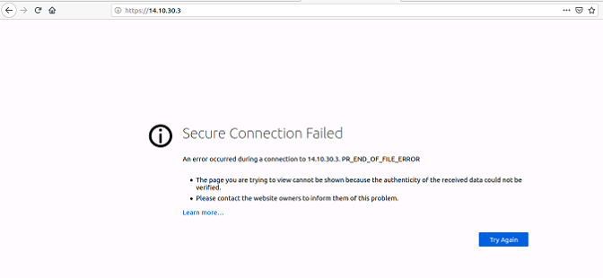

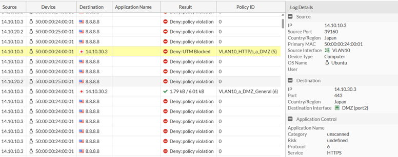

---

## Detalles de los equipos

### Web Server: Sistema de Caja

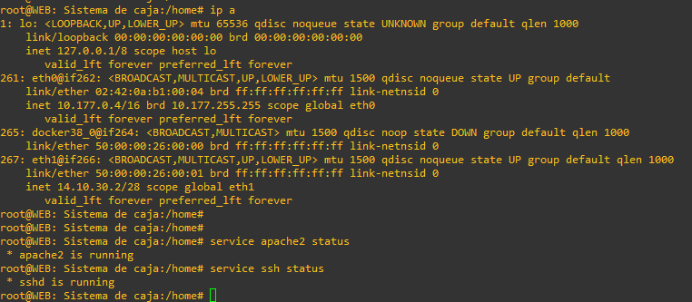

### Web Server: Sistema de Inventario

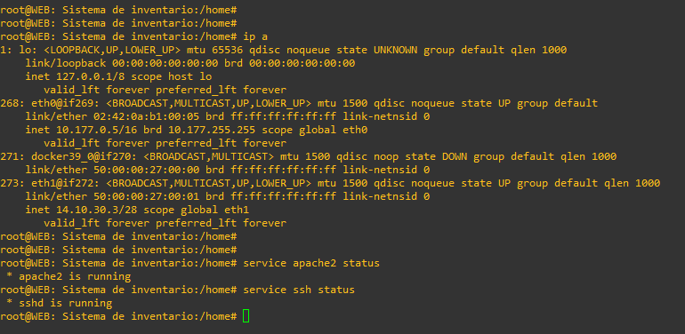

### DB Server

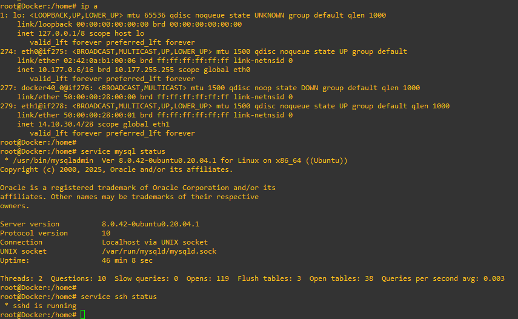

### Usuarios VLAN 10

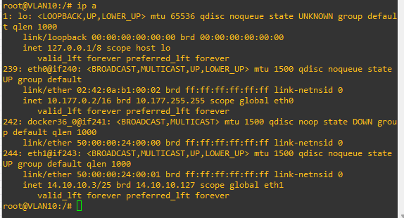

### Usuarios VLAN 20

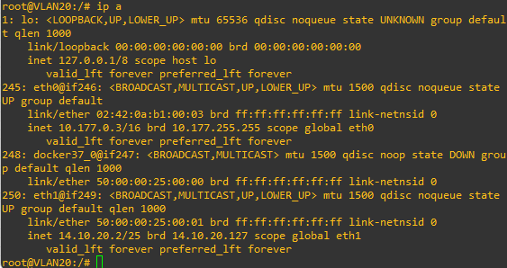
